<p align="center">
  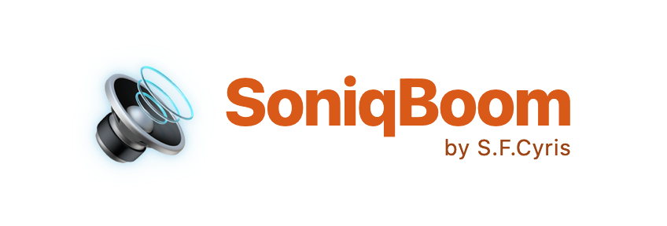
</p>

<p align="center"><strong>The self-hosted music server that actually plays the formats every other server forgot.</strong></p>

<p align="center">
  SID &bull; MOD &bull; XM &bull; IT &bull; AHX &bull; HivelyTracker &bull; NSF &bull; SPC &bull; VGM &bull; MIDI<br>
  &mdash; plus FLAC, DSD, and every modern codec, rendered with the same obsessive care.
</p>

<p align="center">
  Self-hosted &bull; Browser-based &bull; Zero cloud &bull; Zero telemetry &bull; AGPL-3.0
</p>

<p align="center">
  <a href="https://github.com/SFCyris/SoniqBoom/blob/main/LICENSE"></a>
  <a href="https://github.com/SFCyris/SoniqBoom/releases/latest"></a>
  <a href="https://github.com/SFCyris/SoniqBoom/pkgs/container/soniqboom"></a>
  <a href="https://www.python.org/downloads/"></a>
</p>

<p align="center">
  <strong><a href="https://github.com/SFCyris/SoniqBoom/releases/latest/download/soniqboom-latest.zip">⬇&nbsp; Download the latest release</a></strong>
  &nbsp;·&nbsp; <a href="https://github.com/SFCyris/SoniqBoom/releases/latest">release notes</a>
</p>

---

## What is SoniqBoom?

**SoniqBoom is a free music server you run on your own computer.**

Install it on a **Mac or Linux** machine, point it at your music folders, and listen from any web browser on your network — phone, laptop, tablet, anything.

It plays your everyday files (FLAC, MP3, ALAC, and the rest) **and** the retro formats most servers can't: SID, MOD, chiptunes, AdLib, dozens more. No cloud, no account, no tracking — it all stays on your machine.

<p align="center">
  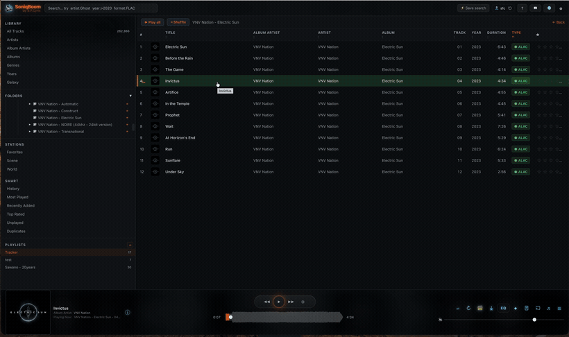
</p>
<p align="center"><sub>Your whole library, in the browser — browse, search, queue, and play, with a live now-playing bar and per-track queue.</sub></p>

---

## Install &amp; run it

The steps are **identical on macOS and Linux**. Three commands: download, install, run.

> **On Windows, or want to run it in a container** (Raspberry Pi, a home server)? This native installer is macOS/Linux only — use the Docker guide instead → **[DEPLOY.md](DEPLOY.md)**.

> **Before you start:** open the **Terminal** app. Copy the block below, paste it in, and press Enter. That's the whole install.

```bash
# 1 — Download and unpack
curl -LO https://github.com/SFCyris/SoniqBoom/releases/latest/download/soniqboom-latest.zip
unzip soniqboom-latest.zip
cd soniqboom-*/        # opens the folder you just unzipped

# 2 — Install everything (same command on macOS and Linux)
bash install.sh

# 3 — Start it
bash run.sh
```

Then open **<http://localhost:8080>** in any browser. That's it. 🎉

> Macs and most Linux desktops already include `curl` and `unzip`. On a bare-bones Linux box that's missing them, install them once first — e.g. `sudo apt install -y curl unzip` (or `dnf` / `pacman` / `zypper`).

**What each step does:**

1. **Download** — grabs the latest release and unzips it.
2. **`bash install.sh`** — installs Python, ffmpeg, and the retro-format players for you (Homebrew on macOS; apt / dnf / pacman / zypper on Linux). On a fresh machine it may ask for your **computer password** so it can install those. On an interactive terminal it then **asks you to create your admin login** — pick a username and a password (at least 8 characters); this is the account you'll sign in with. (If it doesn't prompt — for example you pasted all three commands at once — just create the login afterward with `bash setup-admin.sh`.)
3. **`bash run.sh`** — starts the server in the background and prints the address to open. (If port 8080 is already in use, run `bash run.sh --port 9090` to pick another.)

> *Prefer git?* `git clone https://github.com/SFCyris/SoniqBoom.git && cd SoniqBoom`, then run steps 2 and 3.

If anything looks missing afterwards, just **re-run `bash install.sh`** — it's safe to run as many times as you like and only fills in what's absent.

---

## Run it with Docker

Prefer a container — a Raspberry Pi, a home server, or Windows via Docker Desktop? A prebuilt multi-arch image (Intel/AMD **and** ARM) is published on GHCR, so there's nothing to build.

```bash
# 1 — Start it.  The named volume keeps your index, config, and logs across
#     restarts; swap /path/to/your/music for your library (or drop that -v line
#     to start empty and add folders later from the UI).
docker run -d --name soniqboom -p 8080:8080 \
  -v soniqboom-data:/data \
  -v /path/to/your/music:/music:ro \
  --restart unless-stopped \
  ghcr.io/sfcyris/soniqboom:latest

# 2 — Create your admin login (any username + a password of 8+ characters).
#     New users are admins by default; the change goes live with no restart.
docker exec soniqboom soniqboom-setadm -user me -passwd 'change-this-password'

# 3 — Log in.
#     Open  http://localhost:8080  and sign in with:  me  /  change-this-password
```

Once you're in, click the **gear icon** (top-right) and add a library folder — `/music` if you mounted it above, or any local / FTP / SMB / WebDAV path. Internet **Radio** plays right away with no library at all.

Using **Docker Compose** instead, or want automatic HTTPS? See the full guide → **[DEPLOY.md](DEPLOY.md)**.

---

## First-time setup

1. **Sign in.** Open <http://localhost:8080> and log in with the admin username and password you created during install.
2. **Add your music.** Click the **gear icon** (top-right) to open the admin panel, enter a folder path, and click **Add**. Local folders work, and so do **FTP, SMB, and WebDAV** shares — no mounting required.
3. **Wait for the scan** (about 2 minutes per 50,000 tracks), then close the panel. Your library is ready.

---

## Handy commands

Run these from inside the SoniqBoom folder:

| You want to… | Command |
|--------------|---------|
| **Start the server** | `bash startup.sh` (same as `bash run.sh`) |
| **Change the port** (default is 8080) | `bash run.sh --port 9090` |
| **Stop the server** | `bash shutdown.sh` |
| **Restart the server** | `bash restart.sh` |
| **Rebuild the retro-format players** | `bash install.sh --rebuild` |
| **Delete the built-from-source players** | `bash install.sh --clean` |
| **Skip the slow zxtune build** (the PSF family, MED 2–4 modules and VGM files using chips libgme lacks won't play) | `bash install.sh --slim` |
| **Create or reset your admin login** | `bash setup-admin.sh` |
| Set an admin login non-interactively | `bash setup-admin.sh -user alice -passwd 'your-password'` |

> Usernames are 2–64 characters (letters, digits, `.`, `_`, `-`); passwords are at least 8 characters. Add more people with `bash setup-admin.sh -user bob -passwd '…' -role readonly` (roles: `admin`, `edit`, `readonly`), or invite them from the admin UI once you're signed in. If the server is already running, the change takes effect right away (`setup-admin.sh` tells it to reload).

> **`install.sh` sets up every renderer for you** — `sidplayfp` (SID), `fluidsynth` (MIDI), `libopenmpt` (trackers), `uade` (AHX and the Amiga exotics), `libgme` (console chiptunes), `adplay` (AdLib/OPL), `psgplay` (SNDH), `sc68` (`.sc68`), `zxtune123` (PSF family, MED 2–4 modules, and VGM files that use a chip libgme lacks), `lha` from lhasa (LHA archives), and a static `ffmpeg`. If one ever fails to install, SoniqBoom names the exact missing package and everything else keeps working. (HivelyTracker `.hvl` needs nothing extra — it's bundled and compiled on first run.)
>
> If a player ever stops working after a system update, `bash install.sh --rebuild` rebuilds the players SoniqBoom compiles from source (the rest are managed by your package manager). `bash install.sh --clean` just removes them. In a hurry? `bash install.sh --slim` skips the slow `zxtune123` build (~10–15 min on macOS) — the **PSF family** (PSF, PSF2, USF, GSF, 2SF, NCSF, SSF, DSF), MED 2–4 modules and VGM files that use a chip other than the Sega PSG/YM2612 won't play, and re-running without `--slim` adds them back. `bash install.sh --help` lists all the options. On startup SoniqBoom also checks every player and logs a one-line health summary, so a broken one is easy to spot.

---

## Retro formats, first-class

SoniqBoom treats **demoscene, chiptune, and tracker formats as first-class citizens** — rendered on the fly, tagged with *real* scene metadata, visualized channel by channel, and streamed to any browser — with casting to Chromecast, AirPlay, and DLNA receivers in Beta.

Then, once you're hooked, you'll notice it's *also* a ruthlessly fast, fully-featured modern music server.

<p align="center">
  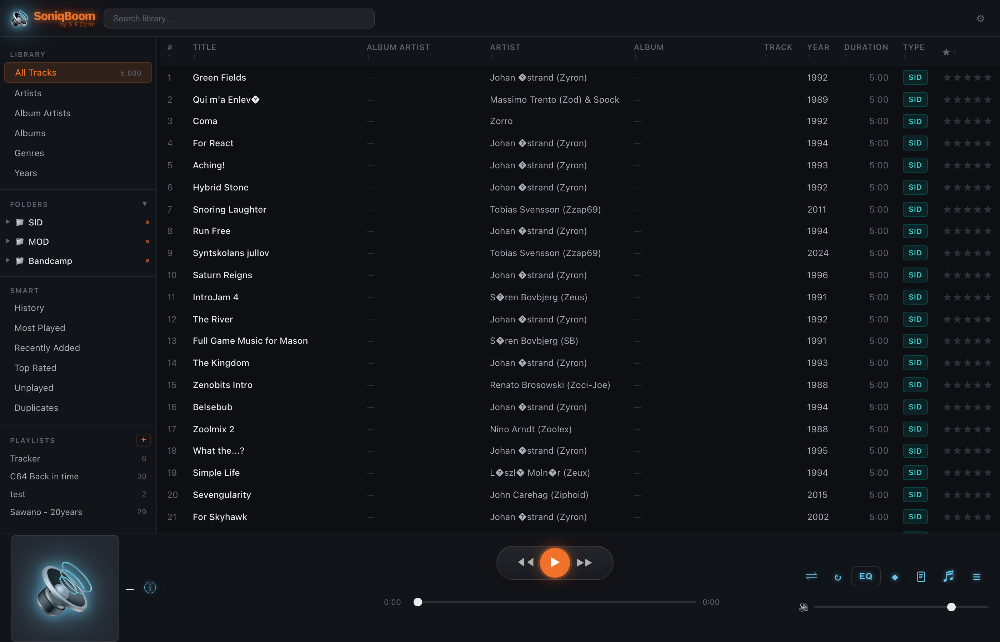
</p>

---

## Every format the others gave up on

**🎮 Chiptune & console** — SID (C64), NSF / NSFe (NES), SPC (SNES), GBS (Game Boy), VGM / VGZ (Sega & arcade), AY (ZX Spectrum / Amstrad), KSS (MSX), SAP (Atari), GYM, HES.

**🎹 Tracker / module** — ProTracker (MOD), FastTracker 2 (XM), Impulse Tracker (IT), ScreamTracker 2 & 3 (STM / S3M), OctaMED, MultiTracker, DigiBooster Pro, Composer 669, UltraTracker, Oktalyzer, Imago Orpheus, Farandole, General DigiMusic, SoundFX, Grave Composer, DSIK… roughly twenty module formats in all.

**🕹️ Amiga heritage** — AHX *and* HivelyTracker (`.hvl`), the latter via a **bundled HivelyTracker engine compiled on first run**. We render the unrenderable.

**🟥 AdLib / OPL2 FM** — the sound of DOS gaming: id Software / Apogee **IMF** (Wolfenstein 3D, Commander Keen, Duke Nukem), plus ROL, CMF, D00, RAD, LucasArts LAA, Sierra SCI, DOSBox DRO, HSC, RIX… rendered through **AdPlug**. (`.imf` files are detected automatically: Imago Orpheus modules play via the tracker engine, id Software IMF via the OPL synth.)

**🎼 MIDI** — synthesized with swappable SoundFonts, plus a one-click SoundFont marketplace. The Docker image includes a General-MIDI SoundFont; on a native install, add one under gear → **Renderers → Soundfonts** (download from the list or upload your own) before MIDI plays.

**…and the everyday stuff, of course** — FLAC, ALAC, MP3, AAC, Ogg Vorbis, Opus, WavPack, Musepack, WAV, AIFF, and 1-bit **DSD** (DSF / DFF / WSD). ZIP and Amiga LHA/LZH archives are scanned *inside the archive* (a ZIP inside a ZIP too), as are C64 `.d64`/`.d71`/`.d81` and Amiga `.adf` disk images, so your `modarchive_2007.zip` hoard simply works — no unpacking.

> Forty-plus retro formats. One unified render pipeline. Zero "unsupported file" dead ends.

---

## We don't just play them. We understand them.

SoniqBoom speaks the culture:

- **🎚️ Per-channel VU meters for tracker modules.** Watch every Paula voice and sample slot dance in real time, right in the browser. Your `.it` files have never looked like this.
- **🧬 Real SID metadata from HVSC.** Per-tune song lengths straight from `Songlengths.md5` — so your SID tunes show *correct* durations instead of a flat three-minute guess — plus full **STIL** credits for every subtune.
- **🎼 Module credits from the audacious-uade-tools song database.** Download it once under **gear → Metadata** and your Amiga and tracker modules get their artist, game or demo, publisher, release year and, for many, their song length — matched by checksum against about 380,000 modules compiled from some 400 scene sources ([audacious-uade-tools](https://github.com/mvtiaine/audacious-uade-tools) by Matti Tiainen, licensed [CC BY-NC-SA 4.0](https://creativecommons.org/licenses/by-nc-sa/4.0/)).
- **🎮 Game names from archive names.** An Amiga TFMX tune inside `Turrican.lha` or an SPC rip inside `Super_Mario_World.zip` gets its game from the archive's name when that name is a known game of the tune's platform, checked against the included title lists of Wikidata, No-Intro, the MAME software lists and ZXDB and, on request, TOSEC and Redump (their downloads are kept: a removed list is added again without downloading, TOSEC is downloaded again only for a newer release, and an Update rebuilds a Redump list only when its contents changed). How a retro track's game is chosen — a game you type (or an album you set on a retro track) always wins; otherwise the first of these that names one:
  1. **The file itself** — the game in an SPC, NSF/NSFe, GBS, VGM/VGZ or PSF-family header, or a GAME tag
  2. **Modland** — the game folder of the tune's exact Modland match
  3. **Demozoo** — the game the tune is the soundtrack of, when composer, title and game name match
  4. **The song database** (audacious-uade-tools) — the game of an exact checksum match
  5. **A Modland file name** such as `gold of the aztecs-intro` (spelled as the title lists spell the game), while *Guess game from Modland file names* is on
  6. **The archive's name**, when it is a known game of the track's platform, while *Game from archive names* is on
  7. **The folder or archive name**, while *Album from folder name for retro formats* is on

  The names the other sources give become the game's other names (Track Info's *also* line; `game:` search finds any of them).
- **🏷️ Retro genres.** Chip tunes and modules with no genre tag are listed under what SoniqBoom knows about them: **Game**, **Demo**, **Cracktro**, **Music Disk**, **Diskmag** or **Scene** — from the track's game, console-rip formats, Demozoo (the production released the same year that uses the tune, and the party competition the tune entered), the composer's Demozoo group, HVSC's `GAMES` / `DEMOS` folders and folders named `games`, `demos`, `cracktros`, `musicdisks` … — plus its platform: **SID**, **Amiga**, **Atari ST**, **NES**, **Game Boy**, **AdLib**, **MIDI** and more. With *Game and group names as genres* (on by default) the game, scene group and party are genres too, so Subsonic apps can browse a game's or a group's tunes. A genre in the file's own tags (other than the format words SoniqBoom adds, such as *Chiptune* or *C64*), or one you type, replaces them.
- **🛰️ The Library Galaxy.** Your entire collection rendered as a drifting star field, every format its own glowing constellation, sized by how much of it you own — or flip to a sortable, searchable list and browse by format family (trackers, chiptune, lossless, lossy).
- **🔌 Live signal-chain visualization.** See the exact decode path of the playing track — `HVL → hvl2wav → PCM → ReplayGain → WebAudio` — laid out and lit up. Honest, nerdy, and weirdly mesmerizing.
- **🗂️ Multi-subtune aware.** SID, SNDH, SC68, Amiga, NSF / GBS / AY / SAP / KSS / HES and HVL files with multiple subsongs are addressed individually, not flattened into one — pick any tune in Track Info or in the phone's Now Playing. Lists and search results show a multi-tune file's count as a badge (`5 tunes`). Playing the file itself starts at its default tune: the start song it names, or for Amiga player formats (played by UADE), console rips and SC68 disks the first tune that isn't empty.
- **📼 Bundled HivelyTracker decoder.** `.hvl` modules play out of the box — nothing extra to install.

<p align="center">
  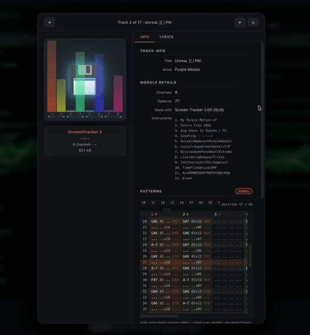
  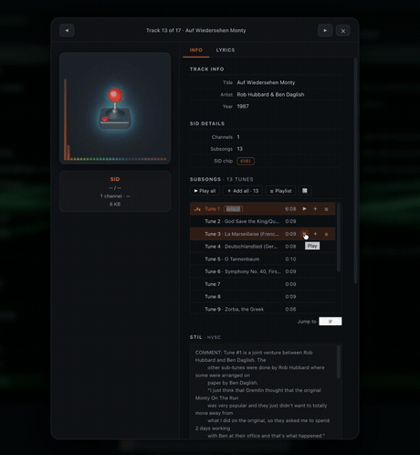
</p>
<p align="center"><sub>Left: a ScreamTracker 3 module with <b>per-channel VU meters dancing in real time</b>, real module metadata, the scene composer's bio, and the live decode path. Right: a Rob Hubbard SID with <b>individually-addressable subsongs</b> and full <b>STIL</b> commentary, straight from HVSC.</sub></p>

<p align="center">
  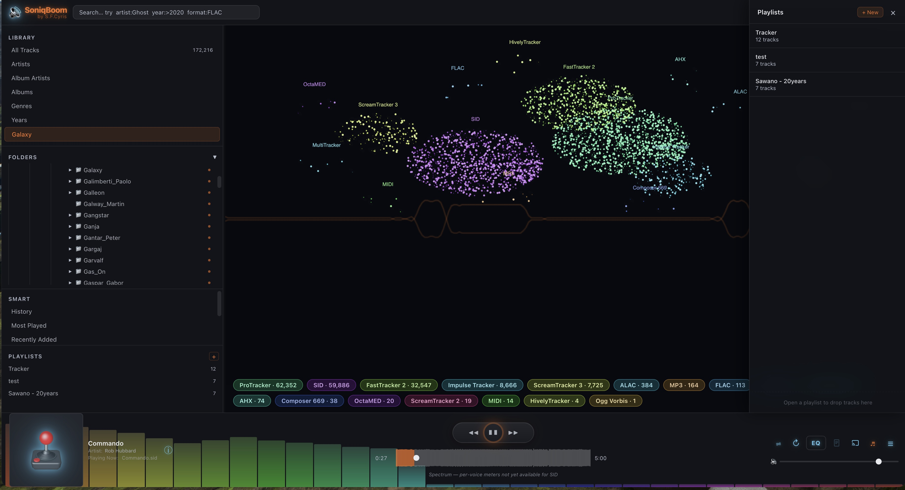
</p>
<p align="center"><sub>The Library Galaxy — your whole collection as a drifting star field, every format its own glowing constellation, sized by how much of it you own.</sub></p>

---

## Oh — and it happens to be a complete modern music server

Every retro format is rendered to standard audio on the fly — a 1987 SID tune streams to your phone *exactly* like a FLAC does (casting it to a HomePod or the speakers in the next room is in Beta). The same server that sees your `.mod` hoard handles your everyday listening.

- **⚡ Entire library held in RAM.** Browse and search a six-figure collection as fast as a ten-song playlist.
- **📻 Internet radio — with the scene built in.** A curated demoscene & chiptune station pack — **SceneSat**, **Nectarine**, **SLAY Radio**, **Kohina**, **Radio PARALAX**, **CVGM**, **Rainwave**, **OverClocked ReMix Radio**, **Keygen-FM** and **CGM UK DemoScene** — alongside the worldwide [Radio Browser](https://www.radio-browser.info/) directory (browse by continent and country), with live now-playing titles and one-click favourites. Stations turn up in the main search too, with a **Show all** view for the full list.
- **🎲 Instant Mix radio.** Press the radio button on any track and SoniqBoom builds an endless, self-refilling queue around it — picked by genre, artist, era, tempo and format — in a focused radio view with a live oscilloscope over the cover. A SID radio stays chiptune; a FLAC radio follows the genre.
- **🔎 More like this & smart playlists.** Surface the closest matches to any song, ranked by what the tracks have in common — artist, genre, era, tempo and format, or for chip tunes and modules the composer, sound chip, replayer, samples and scene group — and, when both have been played, by how their loudness rises and falls. Save any search — say `format:SID year:>1988` — as a playlist that keeps itself up to date.
- **🎚️ 10-band graphic equalizer.** Ten bands from 32 Hz to 16 kHz, seven presets (Rock, Jazz, Vocal…) and clip-safe pre-gain — right in the browser. Press **E** or hit the **EQ** button.
- **🔊 ReplayGain volume levelling.** Even out loudness across the library — choose off, per-track, or per-album, applied live at playback from the file's ReplayGain tags.
- **📡 Cast / AirPlay / DLNA (Beta).** Send anything — yes, even a SID tune, transcoded on the fly — to Chromecast, Apple TV, HomePod, or UPnP receivers. Each needs its Python package installed into SoniqBoom's environment: `pychromecast` (Chromecast), `pyatv` (AirPlay) or `async-upnp-client` (DLNA).
- **🖧 DLNA Media Server (Beta).** Optionally announce your library on the LAN as a UPnP/DLNA MediaServer so any DLNA player — a TV, a console, a network amp — can browse and play it. Off by default; switch it on in gear → **System → Services**.
- **🔁 Multi-room sync.** The same track, in lockstep, across every browser on your LAN — or send a favourite internet-radio station to a whole room, its live station, artist and cover art updating in place.
- **📲 Touch-first mobile UI.** A dedicated phone shell — browse and play your library, tune in internet radio streamed straight to the phone, manage playlists, and a tap-to-expand mini-player.
- **📱 OpenSubsonic API.** Works with Amperfy, Symfonium, DSub, and the rest of the Subsonic app ecosystem — including a **server-owned Jukebox** queue those apps can drive, with the audio playing out through any browser joined to the Jukebox room.
- **🗄️ Network shares without mounting.** Attach FTP, SMB, and WebDAV libraries straight from the admin UI — no OS mount required. MP3, WAV, Ogg, Opus and seekable FLAC files on a share start playing while they download, and a track inside a large ZIP on a share is read on its own, without fetching the whole archive. When a drive or share isn't connected, its tracks stay in the library and are marked **offline** in lists and search results — or hidden, or listed as usual (gear → **System → Settings → Tracks on unavailable drives**). Marked or hidden tracks are skipped by shuffle, Instant Mix and the next track. A track on a share whose file is already in the cache still plays.
- **🌐 The Modland catalogue.** One switch (gear → **Library → External sources**) lists [Modland](https://ftp.modland.com/)'s module archive in your library — about 330,000 tunes of Amiga, C64, Atari ST, console and tracker music, or about 415,000 with the big PC tracker folders — under a **Modland** folder, browsable and searchable right away. Nothing is copied: a tune is downloaded from Modland (with the sample or library files its format needs) when you play it or open its Track Info — and, if you choose *For tunes shown in lists*, SC68, SNDH and multi-tune console chiptunes (NSF, NSFe, GBS, HES, KSS, AY, SAP) are also read when a list shows them — and then plays from SoniqBoom's remote cache; that first download fills in its length, its tunes and its own tags, as for a file of your own. With Modland's checksum list installed (gear → Metadata → Scene origin), Amiga modules show how many tunes they hold before that when the song database is installed, and HVSC SIDs when HVSC's song lengths are set up. The index is refreshed daily, weekly, every 2 weeks or monthly (your choice) or on demand, and a refresh usually downloads only Modland's changelogs since the last one — a few kilobytes. A moved or renamed tune keeps its ratings, play counts and playlist entries. Subsonic apps and the DLNA Media Server (Beta) don't see the catalogue unless you switch that on.
- **👥 Multi-user with roles**, **last.fm + ListenBrainz scrobbling**, **time-synced lyrics**, **podcast & audiobook chapters**, **in-browser tag editing**, **field-operator search** (`artist:Ghost year:>2020 format:FLAC`), **dark mode**, **installable PWA**, and **absolutely zero telemetry**.

<p align="center">
  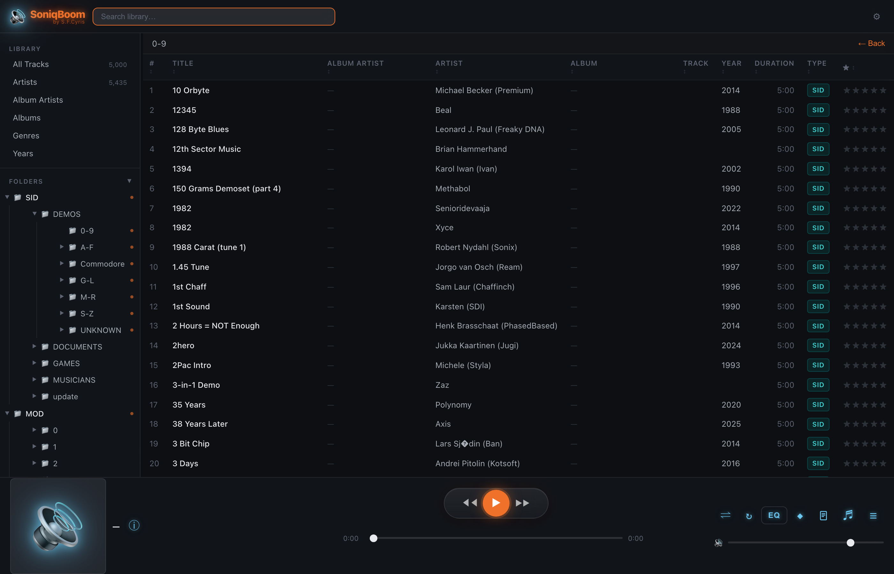
  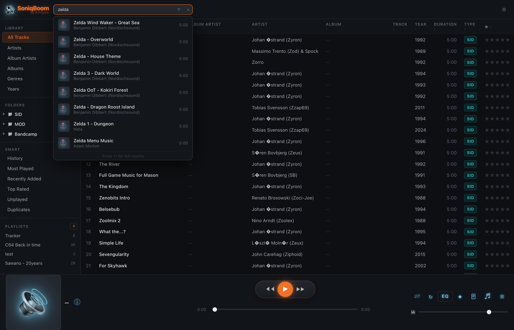
</p>
<p align="center">
  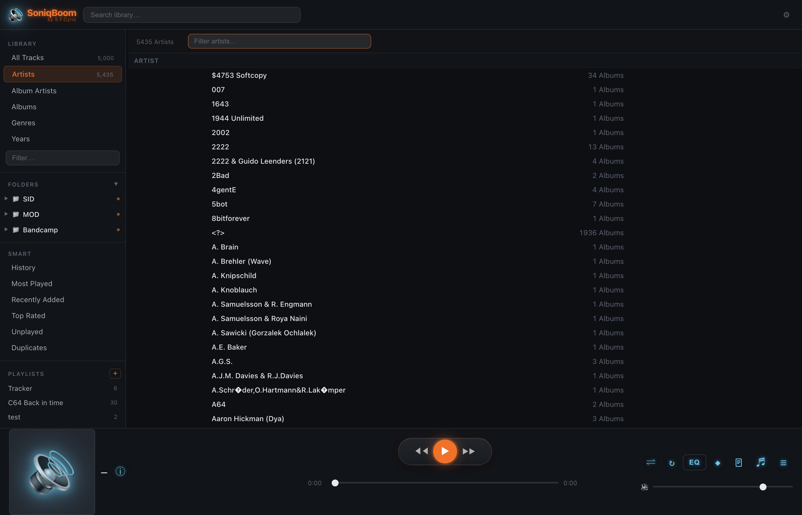
  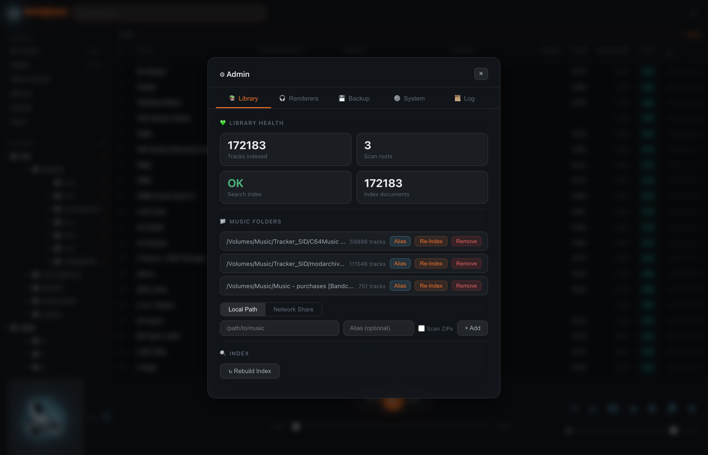
</p>
<p align="center">
  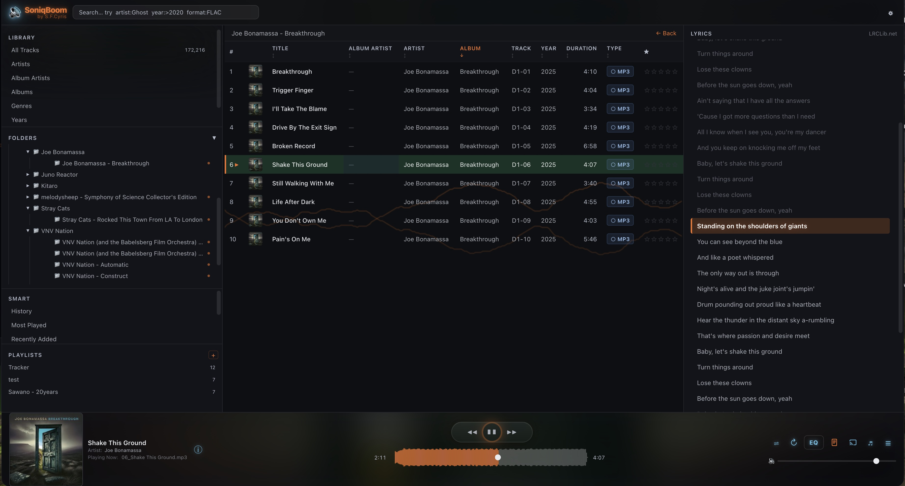
</p>
<p align="center"><sub>Time-synced lyrics scroll line-by-line with playback — fetched from LRCLib when the file has none embedded.</sub></p>

<p align="center">
  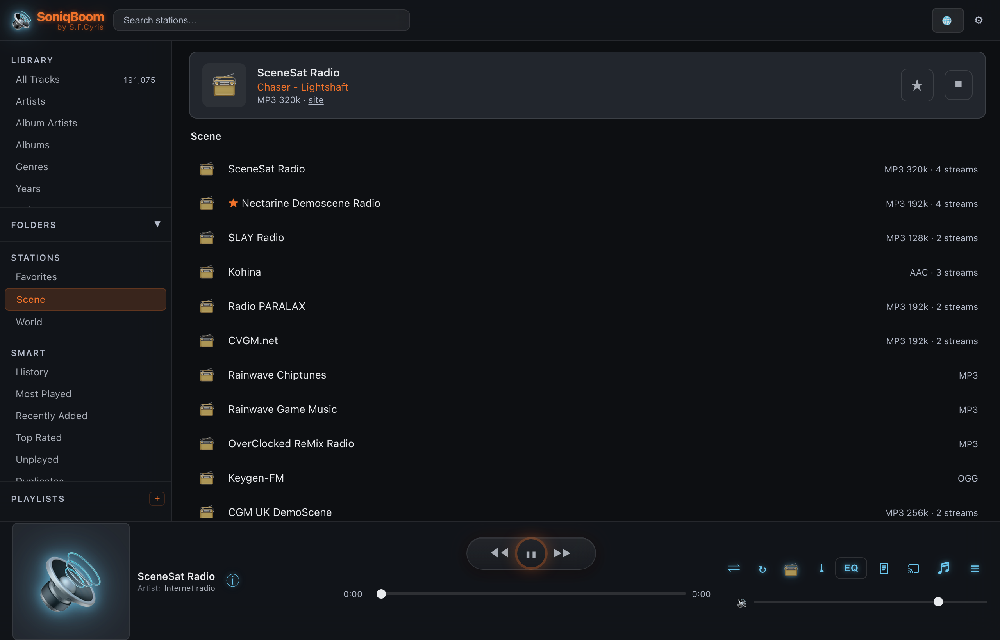
</p>
<p align="center"><sub>Internet-radio <b>Stations</b> — a curated demoscene/chiptune pack plus the worldwide Radio Browser directory (continent → country), with the live now-playing track and one-click favourites.</sub></p>

<p align="center">
  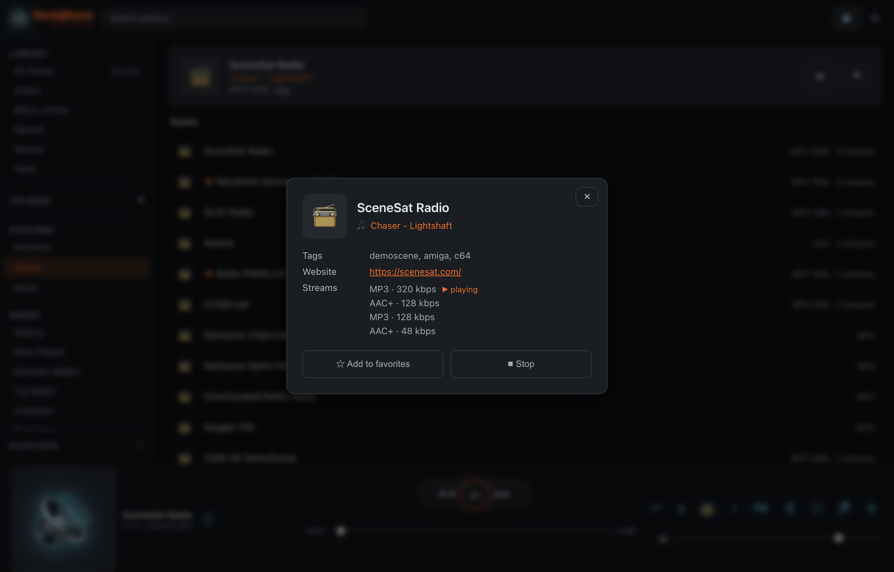
  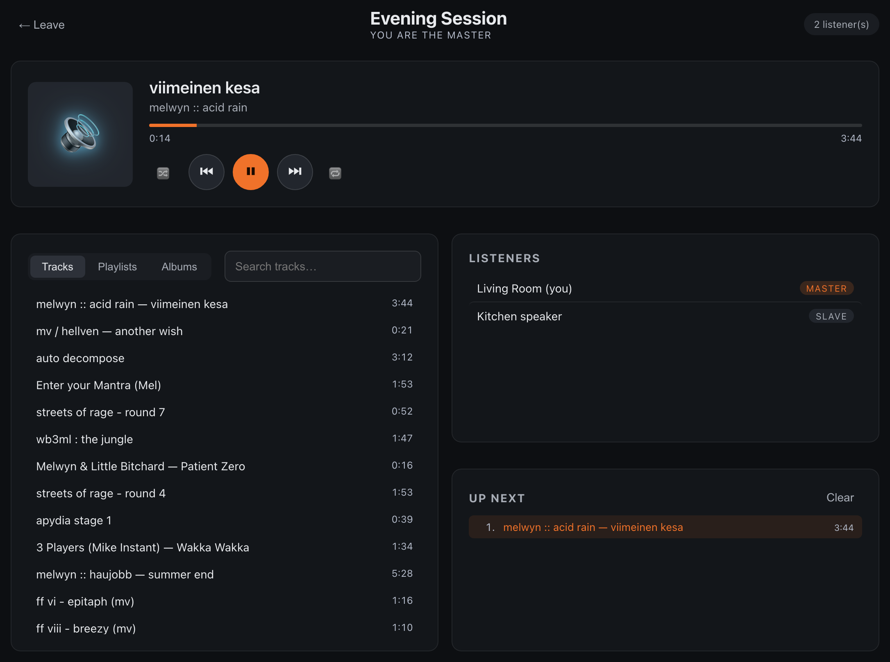
</p>
<p align="center"><sub>Left: a <b>scene radio</b> station up close — tags, website, the live now-playing track, and every available stream quality. Right: <b>multi-room sync</b> — the same track, in lockstep, across every browser on your LAN.</sub></p>

---

## Supported formats

| Family | Formats | Rendered by |
|--------|---------|-------------|
| **Lossless / PCM** | FLAC, ALAC (M4A), WAV, AIFF, WavPack | native / ffmpeg |
| **Lossy** | MP3, AAC, Ogg Vorbis, Opus, Musepack | native / ffmpeg |
| **DSD (1-bit)** | DSF, DFF, WSD | ffmpeg |
| **SID** (C64) | `.sid`, `.psid`, `.rsid` | sidplayfp + HVSC Songlengths & STIL |
| **MIDI** | `.mid`, `.midi` | FluidSynth + SoundFonts |
| **Tracker / module** | MOD, S3M, XM, IT, MTM, MED, OCT, 669, DBM, ULT, STM, FAR, AMF, GDM, IMF *(Imago Orpheus)*, OKT, SFX, WOW, DSM | libopenmpt *(MED 2–4 modules: zxtune123)* |
| **Amiga** | AHX, HivelyTracker (HVL) | uade123 / bundled HivelyTracker engine |
| **Amiga exotics** | ~175 custom players: TFMX *(Turrican)*, Future Composer, SidMon 1/2, David Whittaker, Rob Hubbard, Jochen Hippel (+COSO/ST), Delta Music, SoundMon, JamCracker, Sonic Arranger, SoundFactory *(also when saved as `.psf`)*, ProWizard-packed MODs… — both Amiga prefix naming (`mdat.song`) and suffix naming, companion sample files resolved automatically | uade123 (runs the original Amiga player code) |
| **Atari ST** | SNDH *(with per-track TIME/subsong tags)*, YM register dumps, SC68 | psgplay / bundled ST-Sound engine / sc68 |
| **Console rips (PSF family)** | PSF, PSF2 *(PlayStation)*, USF *(N64)*, GSF *(GBA)*, 2SF + NCSF *(NDS)*, SSF *(Saturn)*, DSF *(Dreamcast)* — mini + shared-lib pairs kept together | zxtune123 (Highly Experimental / lazyusf2 / mGBA / vio2sf reference cores) |
| **Console chiptune** | NSF, NSFe, SPC, GBS, VGM, VGZ, AY, KSS, SAP, GYM (incl. packed GYMX), HES | libgme *(VGM/VGZ using a chip other than the Sega PSG and YM2612 — YM2413, YM2151, NES APU, AY-3-8910 …: zxtune123)* |
| **AdLib / OPL2 FM** | id IMF *(Wolfenstein 3D, Keen…)*, ROL, CMF, D00, RAD, LAA, SCI, DRO, HSC, RIX, A2M, ADL, BAM, KSM, AMD | AdPlug (`adplay`, Nuked OPL3 core) |

Archives and disk images are scanned and played **inline** — tracks inside `.zip` files (a ZIP inside a ZIP too), Amiga `.lha`/`.lzh` archives, C64 `.d64`/`.d71`/`.d81` and Amiga `.adf` disk images appear in your library without unpacking (on network shares: ZIP and LHA/LZH).

> **Curious where these formats came from?** [docs/FORMATS.md](docs/FORMATS.md) has the lore — every family's origin, claim to fame, and the stories behind them (why TFMX travels as two files, which chip designer went on to build the PlayStation, what `M.K.` stands for…).

---

## Comparison

How SoniqBoom stacks up against the five self-hosted music servers it's most often weighed against — Navidrome, Jellyfin, Plexamp, Music Assistant, and Lyrion Music Server. Snapshot as of September 2026, taken from each project's own documentation; projects evolve, so check their docs for the latest.

| | **SoniqBoom** | Navidrome | Jellyfin | Plexamp | Music Assistant | Lyrion |
|---|:---:|:---:|:---:|:---:|:---:|:---:|
| **Retro / tracker / chiptune formats** (SID, MOD, XM, IT, AHX, NSF, SPC, VGM, PSF, AdLib…) | ✅ **40+ families** | ❌ | ❌ | ❌ | ❌ | ⚠ via third-party plugin (beta) |
| **Everyday formats** (FLAC, ALAC, MP3, AAC, Opus, DSD) | ✅ | ✅ | ✅ | ✅ | ✅ | ✅ |
| **Free — no paid tier** | ✅ AGPL | ✅ | ✅ | 💰 Plex Pass gates offline, EQ &amp; remote streaming | ✅ | ✅ |
| **Zero cloud · no account · no telemetry** | ✅ | ✅ | ✅ | ❌ account required | ✅ | ✅ |
| **Multi-room sync** (native) | ✅ any browsers on the LAN | ❌ | ⚠ SyncPlay (video-oriented) | ❌ | ✅ via Home Assistant hub | ✅ via Squeezebox players |
| **Cast — AirPlay · Chromecast · DLNA** | ✅ all three *(Beta)* | ❌ | ⚠ Chromecast; DLNA via plugin | ✅ AirPlay · Chromecast | ✅ all three | ⚠ via bridge plugins |
| **Subsonic / OpenSubsonic API** (Amperfy, Symfonium, DSub…) | ✅ + server-side Jukebox | ✅ | ❌ | ❌ | ❌ | ⚠ via third-party plugin |
| **Internet radio** (Radio Browser directory) | ✅ + curated scene station pack | ⚠ manual station list | ❌ | ❌ | ✅ | ✅ (plugin) |
| **Demoscene metadata** (HVSC song lengths &amp; STIL · Demozoo composer, crew, release year &amp; game soundtracks · audacious-uade-tools module credits, games &amp; lengths) | ✅ | ❌ | ❌ | ❌ | ❌ | ⚠ HVSC song lengths via the retro plugin |
| **Plays tracks inside ZIP archives** (no unpacking) | ✅ | ❌ | ❌ | ❌ | ❌ | ❌ |
| **Network shares without mounting** (FTP · SMB · WebDAV) | ✅ | ❌ | ❌ | ❌ | ✅ (SMB · NFS · WebDAV) | ❌ |
| **In-browser tag editing** (writes real tags) | ✅ | ❌ read-only | ⚠ database only | ⚠ database only | ❌ | ❌ |
| **Graphic equalizer in the web player** | ✅ 10-band | ❌ | ❌ | 💰 Plex Pass | ❌ | ❌ |
| **Tracker visualization** (per-channel VU · live pattern view) | ✅ | ❌ | ❌ | ❌ | ❌ | ❌ |
| **Smart playlists &amp; similar-track suggestions** | ✅ + Instant Mix radio | ⚠ similarity via plugin | ⚠ via plugins | 💰 Plex Pass | ✅ | ⚠ via plugin |

### Where SoniqBoom reigns supreme

- **It plays the formats the others don't.** Forty-plus retro families — SID, ~20 tracker formats, AHX and HivelyTracker, ~175 Amiga player formats, Atari ST, the whole PSF family, console chiptunes, AdLib/OPL2, and MIDI. Of the servers above, only Lyrion plays some of them, through a third-party plugin in beta.
- **Scene metadata** Correct per-tune SID lengths and STIL credits from HVSC, composer, crew, release year and the game a tune was made for from Demozoo, plus module artists, games, publishers, years and many song lengths from the audacious-uade-tools song database - a set of metadata no other server carries.
- **Your ZIP hoards just work.** Tracks inside `.zip` archives appear and play in place; every other server needs them unpacked first.
- **Multi-room that needs nothing extra.** Lockstep playback across any browsers on your LAN — no Squeezebox hardware, no Home Assistant hub.
- **Your files where they already are.** Attach FTP, SMB, and WebDAV shares straight from the admin UI with no OS mount - only Music Assistant comes close.
- **Real tag editing, in the browser.** It writes actual tags; Navidrome is read-only by design, and Jellyfin and Plexamp only edit their own database.
- **A full listening toolkit, free.** A 10-band EQ, ReplayGain, Instant Mix radio, "more like this" ranked by what tracks have in common and how their loudness moves, and self-updating smart playlists — with no paid tier, no account, and no telemetry.
- **Channel-by-channel visualization.** Per-channel VU meters, a live pattern view for tracker modules, and the Library Galaxy — a view of your collection no other server offers.

---

## Configuration

Most settings live in the admin UI. The config file is created for you on first run:

| Platform | Path |
|----------|------|
| macOS | `~/Library/Application Support/SoniqBoom/SoniqBoom.conf` |
| Linux | `${XDG_DATA_HOME:-~/.local/share}/soniqboom/SoniqBoom.conf` |

Environment variables like `SONIQBOOM_HOST` / `SONIQBOOM_PORT` apply when you launch the raw `soniqboom` binary directly. With the helper scripts, change the port with `bash run.sh --port 9090` instead — `run.sh` sets the port explicitly, so it won't read `SONIQBOOM_PORT`. (It does honour `SONIQBOOM_DATA_DIR`.) `SONIQBOOM_SCAN_WORKERS` and `SONIQBOOM_RENDER_SLOTS` set how many scan processes and retro-format renders run at once (default: half the usable CPUs) — see [DEPLOY.md → Configuration](DEPLOY.md#configuration).

---

## Requirements & footprint

Runs on **x86-64 and ARM64** — Raspberry Pi 4/5, ARM cloud servers, Apple Silicon, and ordinary Intel/AMD boxes. The Docker image is multi-arch, so `docker pull` fetches the right one automatically.

Honest, measured numbers (idle, on the ARM64 image):

| | |
|---|---|
| **Idle memory** | ~125 MB with an empty library. The track index lives in RAM, so memory grows with library size — budget more for very large collections and test on your target hardware. |
| **Docker image** | ~1.3 GB on disk, **~400 MB compressed** to pull. Most of it is ffmpeg, the retro-format players and a General-MIDI SoundFont. |
| **CPU** | Idle is near-zero. Retro formats are rendered to audio server-side on play; a SID or tracker module decodes comfortably on a Pi-class core. Large first-time library scans are the main CPU spike. |
| **Disk** | Your music (untouched, read-only) + the `/data` volume (index, conversion cache, config, logs). The conversion cache grows as you play transcoded/retro formats and can be cleared any time. |
| **Modland catalogue** (optional) | About 1 GB more memory with the default *Tunes* selection (about 330,000 tunes), about 1.2 GB with *Everything*; about 200–250 MB more disk for the library index (measured natively on an Apple-silicon Mac). |

**Building the Docker image** and don't need AHX, the Amiga "exotica" family or native `.sc68` disks? Pass `--build-arg SLIM=1` to skip `uade` and `sc68`, two of the players the *image* compiles from source. Everything else — SID, MIDI, trackers, HivelyTracker, YM/SNDH, console chiptune, PSF, AdLib, all modern codecs — still ships, and the build is faster. The **default** image ships everything.

The **native installer** compiles a different set. On macOS it builds `zxtune123`, `sidplayfp`, and `psgplay` from source (`uade` and `sc68` come from Homebrew there), and the zxtune build is the slow one at roughly 10–15 minutes. Its shortcut is `bash install.sh --slim`, which skips only zxtune: the **PSF family** — PSF, PSF2, USF, GSF, 2SF, NCSF, SSF, DSF (PlayStation, N64, GBA, DS, Saturn, and Dreamcast rips) — MED 2–4 modules and VGM files that use a chip other than the Sega PSG / YM2612 won't play until you re-run the installer without `--slim`. (On Linux the same flag skips the prebuilt zxtune download, with the identical effect.)

---

## Who this is for

- **Demosceners & chiptune collectors** whose libraries are invisible to every other server.
- **HVSC / Modland / Modarchive hoarders** who want correct song lengths, STIL credits, and channel-level VU meters — not a generic file list.
- **Hi-fi self-hosters** who *also* keep FLAC and DSD and refuse to run a cloud account to hear them.
- **Anyone** who believes a 40-year-old `.mod` deserves a real player, not a "format not supported" toast.

If your music collection has a weird corner, SoniqBoom is the server that finally lights it up.

**Got a format we don't render?** That's the most interesting kind of bug report. Open an [issue](https://github.com/SFCyris/SoniqBoom/issues) with a sample file, and [star the repo](https://github.com/SFCyris/SoniqBoom) if it earned it. Format and feature ideas are welcome in [Discussions](https://github.com/SFCyris/SoniqBoom/discussions) — the code is maintained by me, but requests and bug reports genuinely steer what's built next.

---

## License

SoniqBoom is licensed under the **GNU Affero General Public License v3.0 or later (AGPL-3.0-or-later)**. See [LICENSE](LICENSE) for the full text.

In short: run, study, modify, and redistribute freely. If you distribute a modified version — including running it as a network service others interact with — you must make the corresponding source of your modifications available under the same license.

Commercial licensing (for use cases that cannot comply with AGPL-3.0's network-use copyleft) is available from the copyright holder on request — contact <scyris@outlook.com>.

SoniqBoom is intended for streaming music you already own or have the right to use. Users are solely responsible for ensuring their use complies with applicable copyright law.

---

## Attributions

SoniqBoom stands on the shoulders of these excellent open-source projects.

- [FastAPI](https://github.com/tiangolo/fastapi) by [Sebastián Ramírez](https://github.com/tiangolo) is licensed under [MIT License](https://github.com/tiangolo/fastapi/blob/master/LICENSE)
- [Uvicorn](https://github.com/encode/uvicorn) by [Encode](https://github.com/encode) is licensed under [BSD-3-Clause](https://github.com/encode/uvicorn/blob/master/LICENSE.md)
- [httpx](https://github.com/encode/httpx) by [Encode](https://github.com/encode) is licensed under [BSD-3-Clause](https://github.com/encode/httpx/blob/master/LICENSE.md)
- [Pydantic](https://github.com/pydantic/pydantic) by [Pydantic](https://github.com/pydantic) is licensed under [MIT License](https://github.com/pydantic/pydantic/blob/main/LICENSE)
- [pydantic-settings](https://github.com/pydantic/pydantic-settings) by [Pydantic](https://github.com/pydantic) is licensed under [MIT License](https://github.com/pydantic/pydantic-settings/blob/main/LICENSE)
- [aiofiles](https://github.com/Tinche/aiofiles) by [Tin Tvrtković](https://github.com/Tinche) is licensed under [Apache License 2.0](https://github.com/Tinche/aiofiles/blob/master/LICENSE)
- [python-multipart](https://github.com/Kludex/python-multipart) by [Marcelo Trylesinski](https://github.com/Kludex) is licensed under [Apache License 2.0](https://github.com/Kludex/python-multipart/blob/master/LICENSE.txt)
- [websockets](https://github.com/python-websockets/websockets) by [Aymeric Augustin](https://github.com/aaugustin) is licensed under [BSD-3-Clause](https://github.com/python-websockets/websockets/blob/main/LICENSE)
- [watchdog](https://github.com/gorakhargosh/watchdog) by [Yesudeep Mangalapilly](https://github.com/gorakhargosh) is licensed under [Apache License 2.0](https://github.com/gorakhargosh/watchdog/blob/master/LICENSE)
- [Mutagen](https://github.com/quodlibet/mutagen) by [Quod Libet](https://github.com/quodlibet) is licensed under [GPL-2.0-or-later](https://github.com/quodlibet/mutagen/blob/main/COPYING)
- [lhafile](https://github.com/FrodeSolheim/python-lhafile) by Hidekazu Ohnishi is licensed under BSD-3-Clause
- [orjson](https://github.com/ijl/orjson) by [ijl](https://github.com/ijl) is licensed under MPL-2.0 AND (Apache-2.0 OR MIT)
- [mido](https://github.com/mido/mido) by [mido](https://github.com/mido) is licensed under [MIT License](https://github.com/mido/mido/blob/main/LICENSE)
- [Pillow](https://github.com/python-pillow/Pillow) by [Python Pillow](https://github.com/python-pillow) is licensed under [MIT-CMU (HPND)](https://github.com/python-pillow/Pillow/blob/main/LICENSE)
- [cryptography](https://github.com/pyca/cryptography) by [PyCA](https://github.com/pyca) is licensed under [Apache-2.0 / BSD-3-Clause](https://github.com/pyca/cryptography/blob/main/LICENSE)
- [PyYAML](https://github.com/yaml/pyyaml) by [YAML](https://github.com/yaml) is licensed under [MIT License](https://github.com/yaml/pyyaml/blob/main/LICENSE)
- [python-dotenv](https://github.com/theskumar/python-dotenv) by [Saurabh Kumar](https://github.com/theskumar) is licensed under [BSD-3-Clause](https://github.com/theskumar/python-dotenv/blob/main/LICENSE)
- [defusedxml](https://github.com/tiran/defusedxml) by [Christian Heimes](https://github.com/tiran) is licensed under [PSF-2.0](https://github.com/tiran/defusedxml/blob/main/LICENSE)
- [smbprotocol](https://github.com/jborean93/smbprotocol) by [Jordan Borean](https://github.com/jborean93) is licensed under [MIT License](https://github.com/jborean93/smbprotocol/blob/master/LICENSE)
- [pyatv](https://github.com/postlund/pyatv) by [Pierre Ståhl](https://github.com/postlund) is licensed under [MIT License](https://github.com/postlund/pyatv/blob/master/LICENSE.md) — optional, installed separately for AirPlay casting (Beta)
- [PyChromecast](https://github.com/home-assistant-libs/pychromecast) by [Home Assistant](https://github.com/home-assistant-libs) is licensed under [MIT License](https://github.com/home-assistant-libs/pychromecast/blob/master/LICENSE) — optional, installed separately for Chromecast casting (Beta)
- [async-upnp-client](https://github.com/StevenLooman/async_upnp_client) by [Steven Looman](https://github.com/StevenLooman) is licensed under Apache-2.0 — optional, installed separately for DLNA casting (Beta)
- [rumps](https://github.com/jaredks/rumps) by [Jared Suttles](https://github.com/jaredks) is licensed under [BSD-3-Clause](https://github.com/jaredks/rumps/blob/master/LICENSE)
- [pyobjc](https://github.com/ronaldoussoren/pyobjc) by [Ronald Oussoren](https://github.com/ronaldoussoren) is licensed under MIT License

External tools (invoked via subprocess) and libraries:

- [FFmpeg](https://ffmpeg.org/) is licensed under [LGPL-2.1-or-later / GPL](https://ffmpeg.org/legal.html) (depending on build configuration)
- [sidplayfp / libsidplayfp](https://github.com/libsidplayfp/libsidplayfp) is licensed under [GPL-2.0-or-later](https://github.com/libsidplayfp/libsidplayfp/blob/master/COPYING) — renders SID; libsidplayfp 2.16.1 with reSIDfp is also included compiled to WebAssembly, which renders SID tunes in the browser for the per-voice VU meter and the optional *Play SID in browser* setting
- [FluidSynth](https://github.com/FluidSynth/fluidsynth) is licensed under [LGPL-2.1](https://github.com/FluidSynth/fluidsynth/blob/master/LICENSE)
- [libopenmpt](https://lib.openmpt.org/libopenmpt/) by [OpenMPT](https://openmpt.org/) is licensed under [BSD-3-Clause](https://lib.openmpt.org/libopenmpt/license/) — renders tracker modules (`openmpt123`) and drives the per-channel VU meters and pattern view
- [UADE](https://zakalwe.fi/uade/) (Unix Amiga Delitracker Emulator) is licensed under GPL-2.0 (its Amiga player files carry their own licences) — renders AHX and the other Amiga formats
- [HivelyTracker replayer](https://github.com/pete-gordon/hivelytracker) by Pete Gordon et al. is licensed under [BSD-3-Clause](https://github.com/pete-gordon/hivelytracker) — vendored to decode `.hvl` modules
- [Game_Music_Emu (libgme)](https://github.com/libgme/game-music-emu) is licensed under [LGPL-2.1](https://github.com/libgme/game-music-emu/blob/master/license.txt)
- [AdPlay](https://github.com/adplug/adplay-unix) (GPL-2.0) with the [AdPlug](https://adplug.github.io/) library ([LGPL-2.1](https://github.com/adplug/adplug/blob/master/COPYING)) — renders AdLib / OPL2 FM formats
- [psgplay](https://github.com/frno7/psgplay) by Fredrik Noring is licensed under [GPL-2.0](https://github.com/frno7/psgplay/tree/main/licence) (some files LGPL-2.1 / MIT) — renders Atari ST SNDH
- [sc68](https://sc68.atari.org/) by Benjamin Gerard is licensed under GPL-2.0-or-later — renders native .sc68 disks
- [zxtune](https://github.com/vitamin-caig/zxtune) by Vitamin/CAIG is licensed under [LGPL-3.0](https://github.com/vitamin-caig/zxtune/blob/master/LICENSE.md) — renders the PSF console-music family
- [ST-Sound](https://github.com/arnaud-carre/StSound) by Arnaud Carré is licensed under BSD/MIT — vendored to decode Atari ST `.ym` files
- [libxmp](https://github.com/libxmp/libxmp)'s XPK-SQSH depacker by Claudio Matsuoka is licensed under MIT — ported to unpack XPK-SQSH packed Amiga modules
- [lhasa](https://github.com/fragglet/lhasa) by Simon Howard is licensed under ISC — the `lha` tool reads LHA archive members the built-in reader can't
- [tini](https://github.com/krallin/tini) is licensed under MIT — the Docker image's init process

Data / assets:

- [FluidR3_GM SoundFont](https://packages.debian.org/bookworm/fluid-soundfont-gm) (MIT) — the General-MIDI SoundFont in the Docker image; more SoundFonts (GeneralUser GS by S. Christian Collins, MuseScore_General and others, each under its own licence) can be downloaded under gear → Renderers → Soundfonts
- [HVSC (High Voltage SID Collection)](https://www.hvsc.c64.org/) (Free archive of SID music) — Songlengths.md5 and STIL metadata from your own HVSC `DOCUMENTS` folder, used for SID playback
- [audacious-uade-tools](https://github.com/mvtiaine/audacious-uade-tools) song database by Matti Tiainen, licensed [CC BY-NC-SA 4.0](https://creativecommons.org/licenses/by-nc-sa/4.0/) — module artists, publishers, albums, years and song lengths; downloaded by the user under gear → Metadata, not included with SoniqBoom
- [Wikidata](https://www.wikidata.org) video-game titles, [CC0 1.0](https://www.wikidata.org/wiki/Wikidata:Licensing) — game titles per retro platform, matched against archive names
- [No-Intro](https://no-intro.org) DAT game titles, [DAT-o-MATIC Data Usage License](https://datomatic.no-intro.org/terms.html) — game titles per retro platform
- [MAME software lists](https://github.com/mamedev/mame/tree/master/hash) titles, CC0 1.0 — game titles per retro platform
- [ZXDB](https://github.com/zxdb/ZXDB) ZX Spectrum game titles, [ODbL 1.0](https://opendatacommons.org/licenses/odbl/1-0/) — contains information from ZXDB, made available under the ODbL
- [TOSEC](https://www.tosecdev.org) and [Redump](http://redump.org) DAT game titles — downloaded by the user under gear → Metadata, not included with SoniqBoom
- [Modland](https://ftp.modland.com/) — Scene origin matches your modules against Modland's checksum list (`allmods_md5.zip`), and the Modland catalogue lists Modland's archive from its index (`allmods.zip`) and downloads a tune from Modland when it is played or its Track Info is opened; downloaded by the user under gear → Metadata → Scene origin (Modland) and gear → Library → External sources, not included with SoniqBoom
- [Demozoo](https://demozoo.org) — composers' scene groups, release years, game soundtracks and the productions and party competitions behind retro genres, from Demozoo's database export; downloaded by the user under gear → Metadata, not included with SoniqBoom

Online services contacted while you use SoniqBoom: [MusicBrainz](https://musicbrainz.org), [Wikidata](https://www.wikidata.org) and [Wikipedia](https://en.wikipedia.org) (artist bios), the [Cover Art Archive](https://coverartarchive.org) and, with a token, [Discogs](https://www.discogs.com) (covers for the song playing on a radio station), [LRCLib](https://lrclib.net) and [lyrics.ovh](https://lyrics.ovh) (lyrics), [Radio Browser](https://www.radio-browser.info/) and the stations of the scene pack (radio), the Demozoo API (scener and production details), and [last.fm](https://www.last.fm) / [ListenBrainz](https://listenbrainz.org) (scrobbling, once you connect an account).

The components, their licences and how SoniqBoom uses them are listed in [THIRD-PARTY-LICENSES.md](THIRD-PARTY-LICENSES.md).

**SoniqBoom license:** [AGPL-3.0-or-later](LICENSE)

---

<p align="center">
  <strong>Point it at the weird corner of your collection. Watch it light up.</strong><br>
  <a href="https://github.com/SFCyris/SoniqBoom">github.com/SFCyris/SoniqBoom</a> &middot; <a href="https://github.com/SFCyris/SoniqBoom/issues">Issues</a>
</p>

<p align="center"><sub>Copyright &copy; 2026 S.F. Cyris &middot; Built by S.F. Cyris</sub></p>
